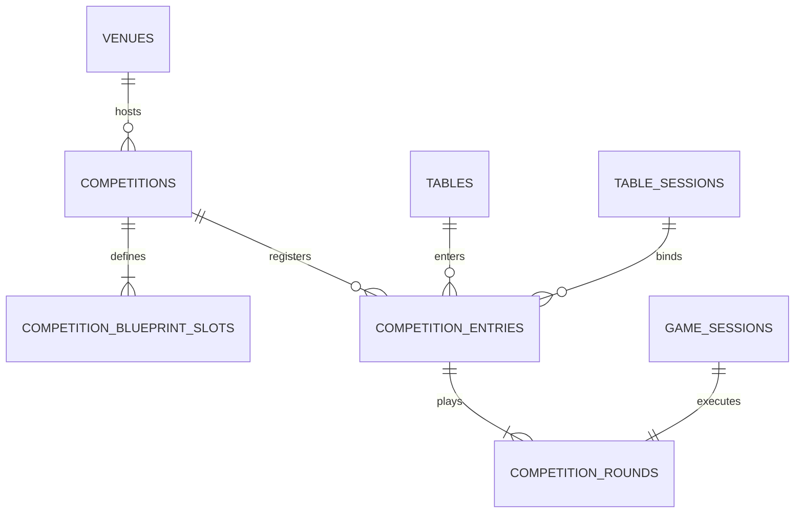

# Implementación PPA-CONTEST-001 — Competencia Diaria de 3 Ciclos + Presencia Wi-Fi

- **ID del Ticket:** `PPA-CONTEST-001`
- **Fecha:** 26 de Noviembre de 2026
- **Estado:** `CLOSED`
- **Ambiente:** Producción (`https://app.puntoburger.com.ar`)
- **Commits asociados:**
  - Implementación: `904c3140acd5406ddd9eca44ca528f5433e25ff5`
  - Documentación: _(este commit)_

---

## 1. Resumen Ejecutivo

PPA-CONTEST-001 transforma la experiencia casual de trivia en Punto Burger en una plataforma de competencia diaria programable y justa entre las mesas físicas del local:

1. **Competencia oficial diaria**: Rango horario programable en zona `America/Argentina/Cordoba`, con registro previo y ventana de finalización con gracia.
2. **Estructura en 3 ciclos**: 30 preguntas totales divididas en 3 ciclos de 10 preguntas cada uno, utilizando sesiones de juego secuenciales (`game_sessions`) ligadas a la misma ocupación física (`table_sessions`).
3. **Curva de dificultad progresiva y balanceada**:
   - Ciclo 1 (Base): 5 initial, 4 medium, 1 advanced (Puntaje máx: 1300 pts).
   - Ciclo 2 (Desafío): 3 initial, 4 medium, 3 advanced (Puntaje máx: 1500 pts).
   - Ciclo 3 (Definitorio): 1 initial, 4 medium, 5 advanced (Puntaje máx: 1700 pts).
   - Puntaje ideal máximo: **4500 puntos**.
4. **Blueprint compartido e imparcial**: Se genera un mapa de 30 slots (`competition_blueprint_slots`) idéntico para todas las mesas (misma categoría y dificultad en cada slot; exactamente 5 preguntas por categoría en las 30 preguntas, distribuidas equitativamente 1 a 2 por ciclo).
5. **Aleatoriedad y Cero Repeticiones**: Cada mesa recibe preguntas diferentes aprobadas para cada slot según su blueprint, garantizando estrictamente **0 preguntas repetidas** a lo largo de los 30 slots de la partida de una mesa.
6. **Descanso entre ciclos**: Al terminar la pregunta 10 de los ciclos 1 y 2, la sesión de mesa NO expira ni entra en cooldown; los comensales descansan y presionan "CONTINUAR AL CICLO X" cuando están listos.
7. **Ranking en Vivo y Final**: Coexistencia transparente con el ranking casual. Durante los días de competencia oficial, `/ranking` exhibe la tabla competitiva clasificada por:
   - Puntaje total acumulado (descendente)
   - Cantidad total de respuestas correctas (descendente)
   - Tiempo acumulado de respuesta en milisegundos (ascendente)
   - Fecha/hora de finalización del Ciclo 3 (ascendente)
   - Fecha/hora de inscripción inicial (ascendente)
8. **Presencia Wi-Fi**: Sistema modular (`VENUE_PRESENCE_MODE`: `off`, `observe`, `enforce`) basado en validación de IP pública del local (`X-PB-Client-IP`), token criptográfico firmado HMAC (`pb_venue_presence`) y refresco periódico transparente cada 30 segundos.

---

## 2. Modelo Relacional de Base de Datos

Se crearon cuatro nuevas entidades en PostgreSQL mediante la migración `0004_omniscient_peter_quill.sql`:



### 2.1. Tablas

1. `competitions`:
   - `id`: UUID (PK).
   - `venue_id`: UUID (FK a `venues`).
   - `name`: Nombre descriptivo (ej: "Torneo Nocturno Esperanza").
   - `local_date`: Fecha local en formato `YYYY-MM-DD`. Restricción de unicidad `(venue_id, local_date) WHERE is_test = false`.
   - `starts_at`, `ends_at`: Ventana principal de competencia.
   - `registration_opens_at`: Apertura de inscripciones (default 30m antes).
   - `join_cutoff_at`: Cierre de nuevas inscripciones (default 30m antes del fin).
   - `finalization_grace_until`: Tolerancia para concluir ciclos en curso (default 30m después del fin).
   - `status`: `'scheduled' | 'active' | 'finalized'`.
   - `is_test`: Booleano para aislamiento de pruebas de humo sin alterar ranking oficial.

2. `competition_blueprint_slots`:
   - `id`: UUID (PK).
   - `competition_id`: UUID (FK).
   - `slot_number`: Entero 1 a 30 (índice único compuesto `(competition_id, slot_number)`).
   - `round_number`: 1, 2 o 3.
   - `difficulty`: `'initial' | 'medium' | 'advanced'`.
   - `category_id`: UUID (FK a `categories`).

3. `competition_entries`:
   - `id`: UUID (PK).
   - `competition_id`: UUID (FK).
   - `table_id`: UUID (FK a `tables`).
   - `table_session_id`: UUID (FK a `table_sessions`).
   - `group_id`: UUID (FK a `groups`).
   - `status`: `'registered' | 'active' | 'completed' | 'abandoned'`.
   - `joined_at`, `completed_at`: Timestamps para desempate y auditoría.

4. `competition_rounds`:
   - `id`: UUID (PK).
   - `competition_entry_id`: UUID (FK a `competition_entries`).
   - `round_number`: 1, 2 o 3.
   - `game_session_id`: UUID (FK a `game_sessions`).

---

## 3. Arquitectura del Blueprint y Selección de Preguntas

### 3.1. Blueprint Inmutable

El generador determinista en [src/modules/competitions/blueprint-generator.ts](file:///Users/jjoaco/Documents/Punto-Papas-App/src/modules/competitions/blueprint-generator.ts) cumple estrictamente:

- 30 slots divididos en 3 rondas de 10 slots.
- Dificultades fijas por ronda:
  - Ronda 1: Slots 1..5 (`initial`), 6..9 (`medium`), 10 (`advanced`).
  - Ronda 2: Slots 11..13 (`initial`), 14..17 (`medium`), 18..20 (`advanced`).
  - Ronda 3: Slot 21 (`initial`), 22..25 (`medium`), 26..30 (`advanced`).
- Las 6 categorías oficiales se distribuyen equitativamente en 5 apariciones cada una ($6 \times 5 = 30$).
- En cada ronda de 10 preguntas, ninguna categoría aparece más de 2 veces, ni menos de 1 vez.

### 3.2. Congelamiento de Preguntas por Mesa

Al iniciar cada ciclo ([src/modules/competitions/competition.service.ts](file:///Users/jjoaco/Documents/Punto-Papas-App/src/modules/competitions/competition.service.ts)):

- Se leen los 10 slots correspondientes del blueprint.
- Se consultan todos los IDs de preguntas ya asignados en ciclos anteriores de esa entrada (`getUsedQuestionIdsForEntry`).
- Para cada slot, se filtra el banco de preguntas por `categoryId`, `difficulty`, estado `approved`, excluyendo las preguntas ya utilizadas.
- Se selecciona una pregunta aleatoria y se congela en `game_questions` con `sequenceOrder = 1..10`.
- Se garantiza **cero duplicación de preguntas en los 30 slots** de cada mesa.

---

## 4. Presencia Wi-Fi Local

### 4.1. Configuración y Modos

Controlado por variables de entorno en [src/lib/env/index.ts](file:///Users/jjoaco/Documents/Punto-Papas-App/src/lib/env/index.ts):

- `VENUE_PRESENCE_MODE`:
  - `off`: Presencia desactivada (default actual en producción).
  - `observe`: Registra logs y emite cookies sin bloquear partidas.
  - `enforce`: Requiere verificación para unirse a competencias y responder.
- `VENUE_ALLOWED_PUBLIC_IPS`: Lista de IPs públicas separadas por coma del router Wi-Fi de clientes en Punto Burger.
- `VENUE_PRESENCE_TOKEN_TTL_SECONDS`: Tiempo de validez del token firmado (90 segundos).
- `VENUE_PRESENCE_SECRET`: Clave HMAC SHA-256 para firma criptográfica.

### 4.2. Detección de IP y Configuración Nginx

La aplicación extrae la IP real del cliente mediante la cabecera `X-PB-Client-IP`. En el servidor de producción DonWeb, Nginx debe reenviar la IP cliente agregando en el bloque `location /`:

```nginx
proxy_set_header X-PB-Client-IP $remote_addr;
```

---

## 5. Endpoints y CLI Operativo

### 5.1. Nuevas Rutas de API

- `GET /api/v1/competitions/current`: Devuelve la competencia activa o programada de hoy.
- `POST /api/v1/competitions/current/join`: Inscribe la mesa activa en la competencia.
- `GET /api/v1/competitions/current/state`: Estado detallado de la competencia y de la mesa.
- `POST /api/v1/competitions/current/rounds/next`: Prepara y avanza al siguiente ciclo (1, 2 o 3).
- `GET /api/v1/competitions/current/ranking`: Tabla de clasificación de la competencia en vivo.
- `GET /api/v1/presence/status`: Estado de verificación de presencia Wi-Fi.
- `POST /api/v1/presence/refresh`: Revalida la IP del cliente y renueva la cookie de presencia.

### 5.2. Herramientas CLI

1. Crear competencia:
   ```bash
   npm run competition:create -- --start "20:00" --end "23:00"
   ```
2. Consultar estado y mesas participantes:
   ```bash
   npm run competition:status
   ```
3. Forzar finalización administrativa:
   ```bash
   npm run competition:finalize
   ```

---

## 6. Coexistencia con Partidas Casuales y Rankings

- **Partidas Casuales**: Fuera del horario de competencia (o en días sin torneo), los clientes continúan jugando la experiencia libre habitual de 10 preguntas. Sus puntajes se registran en el ranking diario casual (`daily_rankings`).
- **Aislamiento**: Las partidas de competencia no interfieren con el ranking diario casual, y las partidas casuales no ingresan a la tabla de la competencia oficial.
- **Transparencia en /ranking**: El componente de ranking detecta automáticamente si hoy existe una competencia oficial y conmuta la vista al torneo de 3 ciclos, con indicador de estado (Programada, En Vivo, Finalizada) y actualización en vivo cada 15 segundos.
